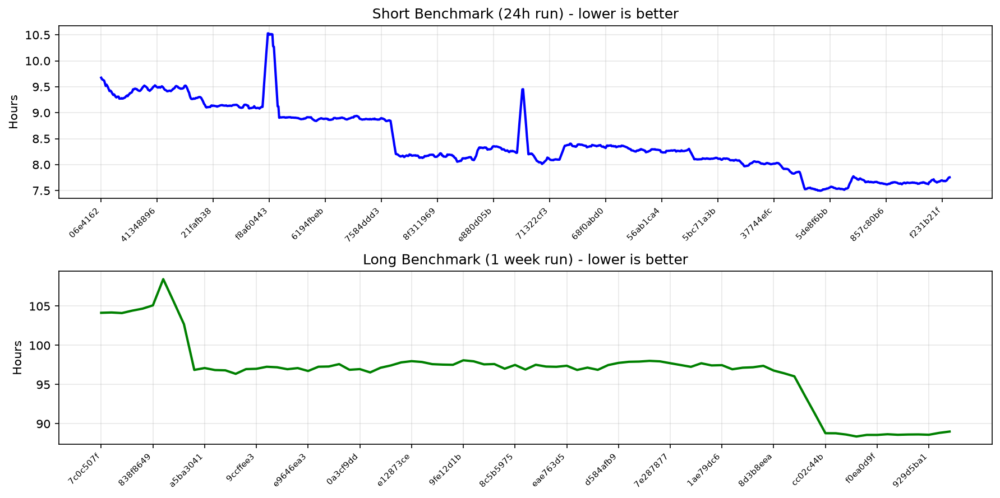

# nimbus-eth1-benchmarks

This repository contains various eth1 import benchmark metrics.

## Running a Benchmark

Benchmarks run on dedicated hosts and are started by the [Benchmark](https://github.com/status-im/nimbus-eth1-benchmarks/actions/workflows/benchmark.yml) workflow. Anyone with write access to this repository can start one from the Actions tab, or with:

```
gh workflow run benchmark.yml -R status-im/nimbus-eth1-benchmarks -f type=short
gh workflow run benchmark.yml -R status-im/nimbus-eth1-benchmarks -f type=short -f commit=<hash> -f force=true
```

Without a commit the next nimbus-eth1 master commit without results is benchmarked. A commit that already has results is only run again with `force`. Each host runs one benchmark at a time, further runs wait in the queue.

The [Benchmark scheduler](https://github.com/status-im/nimbus-eth1-benchmarks/actions/workflows/scheduler.yml) workflow starts a run every hour when master has a commit without results and the host is free. It is enabled per benchmark type through the repository variable `BENCHMARK_SCHEDULE_TYPES`, a JSON list such as `["short", "long"]`.

## Performance Trend



## Latest 5 Short Benchmarks (24 Hour Run)

[View full history](./short-benchmark-history.csv)

${LATEST_SHORT_TABLE}

## Latest 5 Long Benchmarks (1 Week Run)

[View full history](./long-benchmark-history.csv)

${LATEST_LONG_TABLE}

## Performance Changes >1%

All commits with performance changes greater than 1%, sorted chronologically (most recent first). [View regressions](./regressions.csv) | [View improvements](./improvements.csv)

${PERFORMANCE_CHANGES_TABLE}
